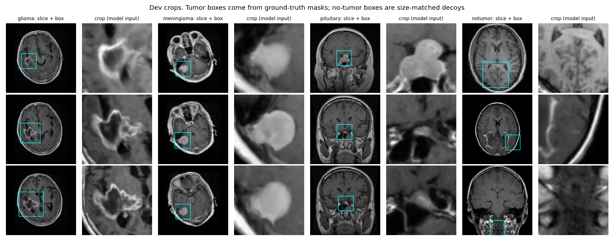

# G03 Brain MRI Triage: Classification (P3)

Owner: Mihir Belose (P3). Checkpoints: "Full-slice baseline running" (Nov 12) and "Segmented
crop pipeline ready" (Nov 15).

ResNet-50 fine-tuned on full MRI slices, and the same setup fine-tuned on tumor crops. The two
differ only in the input, so the comparison isolates the effect of cropping.

## Run it

Needs P1's `integration_project` folder (images + `splits.csv` + `brain_mri_data.py`, see
`P1/README.md`).

```
python train_classifier.py --data-root path/to/integration_project                # full slice
python crop_shortcut_check.py --data-root path/to/integration_project             # crop leak check
python train_classifier.py --data-root path/to/integration_project --input crop   # oracle crops
# colab: --data-root /content/drive/MyDrive/integration_project
```

The crop mode needs P2's `P2/crop_tumor.py` (PR #6). Set `TORCH_HOME=path/to/integration_project/torch_cache`
to reuse the cached ImageNet weights instead of downloading them.

Uses CUDA, then Apple MPS, then CPU. On an M-series Mac it takes ~23 min (about 80s per warm-up
epoch and 115s per fine-tune epoch).

Only train and dev are used. Test isn't touched until the final full vs. crop comparison.

## Setup

| | |
|---|---|
| Model | torchvision ResNet-50, ImageNet weights (`IMAGENET1K_V2`), fc replaced by a 4-class linear head |
| Input | P1 loader: grayscale, pad to square, 224x224, 3 channels, ImageNet norm. Random hflip on train |
| Loss | cross-entropy with `class_weights()` (train imbalance is 2.3x) |
| Warm-up | 2 epochs, backbone frozen, Adam lr 1e-3 on the head only |
| Fine-tune | 10 epochs, everything unfrozen, AdamW lr 1e-4, weight decay 1e-4, cosine schedule |
| Batch | 32 |
| Checkpoint | epoch with the best dev macro-F1 (`results/full_slice/best.pt`, not in git) |
| Seed | 539 |

## Results (dev, best epoch = 12)

| | Dev accuracy | Dev macro-F1 |
|---|---:|---:|
| Majority class (P1) | 33.5% | 0.126 |
| Brightness-only random forest (P1, no tumor info) | 86.5% | 0.843 |
| **ResNet-50 full slice** | **97.1%** | **0.966** |

| Class | Precision | Recall | F1 | n |
|---|---:|---:|---:|---:|
| glioma | 0.981 | 0.942 | 0.961 | 225 |
| meningioma | 0.886 | 0.965 | 0.924 | 113 |
| pituitary | 0.980 | 0.993 | 0.987 | 148 |
| notumor | 1.000 | 0.988 | 0.994 | 245 |

Confusion (rows true, cols predicted):

| | glioma | meningioma | pituitary | notumor |
|---|---:|---:|---:|---:|
| glioma | 212 | 13 | 0 | 0 |
| meningioma | 4 | 109 | 0 | 0 |
| pituitary | 0 | 1 | 147 | 0 |
| notumor | 0 | 0 | 3 | 242 |


Files in `results/full_slice/`: `history.csv` (per-epoch train/dev loss, acc, macro-F1),
`curves.png`, `dev_report.txt`, `dev_per_class_f1.csv`, `dev_confusion.csv`.

## Notes

- Dev plateaus around 97% from epoch 4 while train goes to 100%, so more epochs won't help much.
- Most of the errors are glioma predicted as meningioma (13 of 21).
- No-tumor is near perfect, but P1 showed that's easy from image source alone, so it doesn't
  show the model is looking at tumors. The tumor-only classes are the more honest number here.
- Dev only has ~10-14 patients per tumor class, so per-class F1 is noisy.

## Crop input (Nov 15)

`crop_data.py` runs every image through P2's `crop_tumor_image`: a square box around the mask,
20% padding, a 48 px minimum, resized to 224.

- **Tumor boxes come from the ground-truth masks**, so these are oracle crops and any
  results trained on them are an upper bound. A real input has no ground truth. The final comparison
  needs P2's predicted masks for dev and test.
- **No-tumor images get a size-matched decoy box.** P2's default keeps the full slice for
  no-tumor, which makes zoom alone separate tumor from no-tumor. Instead, each no-tumor image
  gets the height and width of a random train tumor's mask box, centred on a random point inside
  the head, and goes through the same crop call. Dev decoys are fixed per image; train decoys are
  redrawn every epoch.



### Shortcut check

A random forest on 11 brightness statistics of the model input, with no tumor shape information,
fit on train and scored on dev (`crop_shortcut_check.py`, same idea as P1's baseline):

| Input | 4-class acc | 4-class macro-F1 | Tumor vs. no-tumor acc |
|---|---:|---:|---:|
| Full slice | 0.865 | 0.845 | 0.970 |
| Crop, no-tumor kept as full slice (P2 default) | 0.837 | 0.803 | 0.986 |
| **Crop, no-tumor decoy (used here)** | **0.721** | **0.690** | **0.866** |

The decoy lowers the brightness-only bar from 0.845 to 0.690 macro-F1, so the crop classifier
has to rely more on the image content. The remaining 0.866 tumor vs. no-tumor accuracy is partly
genuine (enhancing tumors are bright) and partly the sequence difference P1 found between the
two sources; cropping can't remove that.

Files in `results/crop/`: `shortcut_check.md`, `crop_preview.png`.

## Next

- Nov 18: train on crops (`--input crop`), log per-class dev F1 and curves, draft the full vs.
  crop comparison table. Rerun with P2's predicted masks once they exist.
- Nov 28: one-time test-set comparison, crops from predicted masks only.
