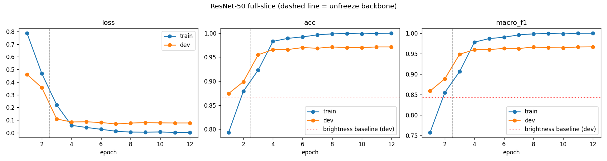
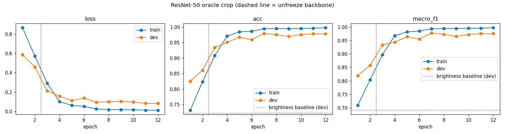

# G03 Brain MRI Triage: Classification (P3)

Owner: Mihir Belose (P3). Checkpoints: "Full-slice baseline running" (Nov 12), "Segmented
crop pipeline ready" (Nov 15), "Fine-tuned classifier complete" (Nov 18) and "Controlled
comparison finalized" (Nov 28).

ResNet-50 fine-tuned on full MRI slices, and the same setup fine-tuned on tumor crops. The two
differ only in the input, so the comparison isolates the effect of cropping.

## Run it

Needs P1's `integration_project` folder (images + `splits.csv` + `brain_mri_data.py`, see
`P1/README.md`).

```
python train_classifier.py --data-root path/to/integration_project                # full slice
python crop_shortcut_check.py --data-root path/to/integration_project             # crop leak check
python train_classifier.py --data-root path/to/integration_project --input crop   # oracle crops
python evaluate.py --data-root path/to/integration_project --split dev            # per-image results
python compare_inputs.py --data-root path/to/integration_project --split dev      # full vs. crop table
python evaluate.py --data-root path/to/integration_project --split test           # final comparison
python compare_inputs.py --data-root path/to/integration_project --split test
# colab: --data-root /content/drive/MyDrive/integration_project
```

The crop mode needs P2's `P2/crop_tumor.py`; `evaluate.py` also reads P2's
`P2/<split>_predicted_masks.npz`. Set `TORCH_HOME=path/to/integration_project/torch_cache`
to reuse the cached ImageNet weights instead of downloading them.

Uses CUDA, then Apple MPS, then CPU. On an M-series Mac it takes ~23 min (about 80s per warm-up
epoch and 115s per fine-tune epoch).

Training and every setting choice use only train and dev. Test was run once, on Nov 26, for
the final comparison below.

## Setup

| | |
|---|---|
| Model | torchvision ResNet-50, ImageNet weights (`IMAGENET1K_V2`), fc replaced by a 4-class linear head |
| Input | P1 loader: grayscale, pad to square, 224x224, 3 channels, ImageNet norm. Random hflip on train |
| Loss | cross-entropy with `class_weights()` (train imbalance is 2.3x) |
| Warm-up | 2 epochs, backbone frozen, Adam lr 1e-3 on the head only |
| Fine-tune | 10 epochs, everything unfrozen, AdamW lr 1e-4, weight decay 1e-4, cosine schedule |
| Batch | 32 |
| Checkpoint | epoch with the best dev macro-F1 (`results/full_slice/best.pt`, not in git) |
| Seed | 539 |

## Results (dev, best epoch = 12)

| | Dev accuracy | Dev macro-F1 |
|---|---:|---:|
| Majority class (P1) | 33.5% | 0.126 |
| Brightness-only random forest (P1, no tumor info) | 86.5% | 0.843 |
| **ResNet-50 full slice** | **97.1%** | **0.966** |

| Class | Precision | Recall | F1 | n |
|---|---:|---:|---:|---:|
| glioma | 0.981 | 0.942 | 0.961 | 225 |
| meningioma | 0.886 | 0.965 | 0.924 | 113 |
| pituitary | 0.980 | 0.993 | 0.987 | 148 |
| notumor | 1.000 | 0.988 | 0.994 | 245 |

Confusion (rows true, cols predicted):

| | glioma | meningioma | pituitary | notumor |
|---|---:|---:|---:|---:|
| glioma | 212 | 13 | 0 | 0 |
| meningioma | 4 | 109 | 0 | 0 |
| pituitary | 0 | 1 | 147 | 0 |
| notumor | 0 | 0 | 3 | 242 |



Files in `results/full_slice/`: `history.csv` (per-epoch train/dev loss, acc, macro-F1),
`curves.png`, `dev_report.txt`, `dev_per_class_f1.csv`, `dev_confusion.csv`.

## Notes

- Dev plateaus around 97% from epoch 4 while train goes to 100%, so more epochs won't help much.
- Most of the errors are glioma predicted as meningioma (13 of 21).
- No-tumor is near perfect, but P1 showed that's easy from image source alone, so it doesn't
  show the model is looking at tumors. The tumor-only classes are the more honest number here.
- Dev only has ~10-14 patients per tumor class, so per-class F1 is noisy.

## Crop input (Nov 15)

`crop_data.py` runs every image through P2's `crop_tumor_image`: a square box around the mask,
20% padding, a 48 px minimum, resized to 224.

- **Tumor boxes come from the ground-truth masks**, so these are oracle crops and any
  results trained on them are an upper bound. A real input has no ground truth, so the final
  comparison below also scores crops from P2's predicted masks.
- **No-tumor images get a size-matched decoy box.** Keeping the full slice for no-tumor
  makes zoom alone separate tumor from no-tumor. Instead, each no-tumor image
  gets the height and width of a random train tumor's mask box, centred on a random point inside
  the head, and goes through the same crop call. Dev decoys are fixed per image; train decoys are
  redrawn every epoch.


### Shortcut check

A random forest on 11 brightness statistics of the model input, with no tumor shape information,
fit on train and scored on dev (`crop_shortcut_check.py`, same idea as P1's baseline):

| Input | 4-class acc | 4-class macro-F1 | Tumor vs. no-tumor acc |
|---|---:|---:|---:|
| Full slice | 0.865 | 0.845 | 0.970 |
| Crop, no-tumor kept as full slice | 0.837 | 0.803 | 0.986 |
| **Crop, no-tumor decoy (used here)** | **0.721** | **0.690** | **0.866** |

The decoy lowers the brightness-only bar from 0.845 to 0.690 macro-F1, so the crop classifier
has to rely more on the image content. The remaining 0.866 tumor vs. no-tumor accuracy is partly
genuine (enhancing tumors are bright) and partly the sequence difference P1 found between the
two sources; cropping can't remove that.

Files in `results/crop/`: `shortcut_check.md`, `crop_preview.png`.

## Crop classifier (Nov 18)

Trained with `--input crop`: the same setup and seed as the full-slice run, only the input
changes. Rerunning it gives the same history and confusion matrix, epoch for epoch.

### Results (dev, best epoch = 7)

| Class | Precision | Recall | F1 | n |
|---|---:|---:|---:|---:|
| glioma | 0.995 | 0.956 | 0.975 | 225 |
| meningioma | 0.982 | 0.982 | 0.982 | 113 |
| pituitary | 0.948 | 0.980 | 0.963 | 148 |
| notumor | 0.984 | 1.000 | 0.992 | 245 |

Confusion (rows true, cols predicted):

| | glioma | meningioma | pituitary | notumor |
|---:|---:|---:|---:|---:|
| glioma | 215 | 1 | 6 | 3 |
| meningioma | 0 | 111 | 2 | 0 |
| pituitary | 1 | 1 | 145 | 1 |
| notumor | 0 | 0 | 0 | 245 |



### Full slice vs. crop (draft, dev only)

From `compare_inputs.py` (`results/comparison_dev.md` also has precision, recall and the confusion
matrices), except the two brightness-only rows, which come from `results/crop/shortcut_check.md`.
That check computes the brightness statistics on the exact model input, which gives 0.845 on
full slices. P1's 0.843 in the full-slice results above uses the same statistics on a plain
224x224 resize, without the loader's pad to square. Crops come from
ground-truth masks, so the crop column is likely optimistic.

| | Full slice | Oracle crop |
|---|---:|---:|
| Dev accuracy | 0.971 | 0.979 |
| Dev macro-F1 | 0.966 | 0.978 |
| Dev errors (of 731) | 21 | 15 |
| Brightness-only macro-F1 on the same input | 0.845 | 0.690 |
| Margin over brightness-only | +0.121 | +0.288 |
| Best epoch | 12 | 7 |

| Class F1 | Full slice | Oracle crop | Change |
|---|---:|---:|---:|
| glioma | 0.961 | 0.975 | +0.014 |
| meningioma | 0.924 | 0.982 | +0.059 |
| pituitary | 0.987 | 0.963 | -0.023 |
| notumor | 0.994 | 0.992 | -0.002 |

- Glioma/meningioma mix-ups drop from 17 to 1 (13 + 4 on full slices, 1 + 0 on crops). All
  other errors rise from 4 to 14, so the net gain is 6 images.
- Crops miss 4 tumors (3 gliomas and 1 pituitary called no-tumor) where the full slice missed
  none, while removing the full slice's 3 no-tumor images called pituitary. Missed tumors matter
  most for triage, so this is the crop model's main weakness.
- The overall difference is 6 dev images, and dev has only ~10-14 patients per tumor class, so
  it isn't conclusive.
- The brightness-only bar is much lower on crops (0.690 vs. 0.845) while the classifier stays
  about the same, so the crop model's margin over brightness alone is more than twice as large.
- Dev macro-F1 peaks at epoch 7 and stays between 0.966 and 0.976 after that; train accuracy
  reaches 99.8%.

Files in `results/crop/`: `history.csv`, `curves.png`, `dev_report.txt`, `dev_per_class_f1.csv`,
`dev_confusion.csv`, `train.log` (`best.pt` not in git).

## Controlled comparison (Nov 28)

`evaluate.py` scores the two saved checkpoints (no retraining) and writes one row per image to
`results/<split>/<setting>.csv`; `compare_inputs.py` builds `results/comparison_<split>.md` from
those files. The crop model is scored three ways:

- **True masks (oracle):** crops around the ground-truth mask, as in training. Upper bound.
- **U-Net masks (pipeline):** crops around P2's predicted mask (`P2/<split>_predicted_masks.npz`).
  No ground truth or label is read. When the mask is empty, P2's `crop_tumor_image` picks a decoy
  box. These are exactly the crops P4's pipeline uses: on dev, every one of the 731 predictions
  matches P4's `dev_results_unet.csv`.
- **U-Net masks, P3 decoy:** the same, but an empty mask gets the size-matched decoy the crop model
  trained on.

All settings were fixed on dev before test was run. The two decoy rules apply to every empty U-Net
mask (on dev, 243 no-tumor images and 52 tumors the U-Net misses), but they change only 21 dev
predictions: 20 on missed tumors, where either rule crops a random patch of brain, and 1 no-tumor
image. The pipeline row uses P2's rule, so the P3 and P4 test numbers agree. The P3-decoy row is
reported as a sensitivity check.

95% CIs come from a patient bootstrap: whole patients are resampled within each class, because
test has only 9-14 patients per tumor class. The change column is paired against the full slice.

### Test results (n = 682, run once)

| | Acc | Macro-F1 | Macro-F1 95% CI | Change vs. full | Change 95% CI | Errors | Missed tumors |
|---|---:|---:|---:|---:|---:|---:|---:|
| **Full slice** | 0.972 | **0.966** | 0.938 to 0.989 | | | 19 | 0 |
| Crop, true masks (oracle) | 0.963 | 0.956 | 0.909 to 0.988 | -0.011 | -0.049 to +0.024 | 25 | 7 |
| **Crop, U-Net masks (pipeline)** | 0.940 | **0.930** | 0.884 to 0.967 | **-0.036** | -0.071 to -0.004 | 41 | 12 |
| Crop, U-Net masks, P3 decoy | 0.931 | 0.923 | 0.875 to 0.960 | -0.043 | -0.077 to -0.013 | 47 | 21 |

| Test class F1 | n | Full slice | Crop, oracle | Crop, pipeline |
|---|---:|---:|---:|---:|
| glioma | 204 | 0.968 | 0.964 | 0.947 |
| meningioma | 97 | 0.943 | 0.928 | 0.918 |
| pituitary | 135 | 0.960 | 0.945 | 0.882 |
| notumor | 246 | 0.994 | 0.986 | 0.972 |

Dev, for reference (`results/comparison_dev.md`): full slice 0.966, oracle crop 0.978, pipeline
crop 0.947, P3 decoy 0.940 macro-F1.

### What it shows

- **Cropping does not beat the full slice.** With U-Net masks, the crop pipeline is 0.036
  macro-F1 below the full slice, and the patient-bootstrap CI excludes zero. Even with true masks,
  the crop model is not better on test (-0.011, CI includes zero). The dev advantage of oracle crops
  (+0.012) did not carry over to test.
- **Missed tumors are the main cost.** The full slice calls no tumor no-tumor on test; the crop
  pipeline misses 12, and the oracle crop 7. For triage, a missed tumor is the worst error.
- **Empty U-Net masks cause most of the drop from oracle to pipeline.** 50 of 436 test tumors
  (11.5%; 36 glioma, 13 pituitary, 1 meningioma) get an empty U-Net mask and so a decoy crop. Of
  the 16 extra test errors, 9 are on those 50 images, 5 on tumors with an imperfect U-Net mask and
  2 on no-tumor images. Pituitary is hit hardest: its F1 falls from 0.945 (oracle) to 0.882.
- **The crop model itself is also weaker on test.** Even with true masks it makes 20 errors on the
  386 test tumors that do get a U-Net mask, against 13 for the full slice.
- **The crop model still leans less on shortcuts.** A brightness-only model reaches 0.690 macro-F1
  on crops against 0.845 on full slices (dev, shortcut check above), so the full slice's higher
  score may partly come from cues outside the tumor, such as the scan-source difference P1 found.
  This comparison can't separate the two.
- **Limits:** one training run per input (seed 539), and test has 9-14 patients per tumor class,
  so the CIs are wide. Figshare images are split by patient; Kaggle no-tumor images have no
  patient IDs and are grouped by near-duplicates.

Files: `results/comparison_test.md` (precision, recall, confusion matrices, U-Net mask counts),
`results/comparison_dev.md`, and per-image results in `results/dev/` and `results/test/`.
