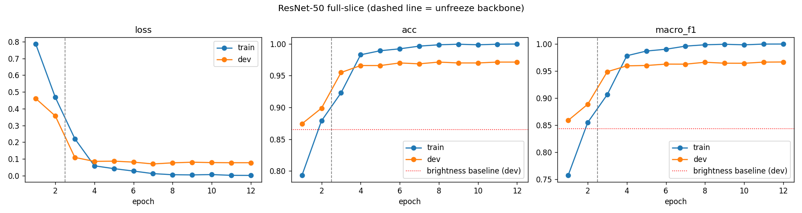

# G03 Brain MRI Triage: Classification (P3)

Owner: Mihir Belose (P3). Checkpoint: "Full-slice baseline running", Nov 12.

ResNet-50 fine-tuned on full MRI slices. This is the benchmark the segmented-crop classifier
gets compared against (same architecture, loss and hyperparameters, only the input changes).

## Run it

Needs P1's `integration_project` folder (images + `splits.csv` + `brain_mri_data.py`, see
`P1/README.md`).

```
python train_classifier.py --data-root path/to/integration_project
# colab: --data-root /content/drive/MyDrive/integration_project
```

Uses CUDA, then Apple MPS, then CPU. On an M-series Mac it takes ~23 min (about 80s per warm-up
epoch and 115s per fine-tune epoch).

Only train and dev are used. Test isn't touched until the final full vs. crop comparison.

## Setup

| | |
|---|---|
| Model | torchvision ResNet-50, ImageNet weights (`IMAGENET1K_V2`), fc replaced by a 4-class linear head |
| Input | P1 loader: grayscale, pad to square, 224x224, 3 channels, ImageNet norm. Random hflip on train |
| Loss | cross-entropy with `class_weights()` (train imbalance is 2.3x) |
| Warm-up | 2 epochs, backbone frozen, Adam lr 1e-3 on the head only |
| Fine-tune | 10 epochs, everything unfrozen, AdamW lr 1e-4, weight decay 1e-4, cosine schedule |
| Batch | 32 |
| Checkpoint | epoch with the best dev macro-F1 (`results/full_slice/best.pt`, not in git) |
| Seed | 539 |

## Results (dev, best epoch = 12)

| | Dev accuracy | Dev macro-F1 |
|---|---:|---:|
| Majority class (P1) | 33.5% | 0.126 |
| Brightness-only random forest (P1, no tumor info) | 86.5% | 0.843 |
| **ResNet-50 full slice** | **97.1%** | **0.966** |

| Class | Precision | Recall | F1 | n |
|---|---:|---:|---:|---:|
| glioma | 0.981 | 0.942 | 0.961 | 225 |
| meningioma | 0.886 | 0.965 | 0.924 | 113 |
| pituitary | 0.980 | 0.993 | 0.987 | 148 |
| notumor | 1.000 | 0.988 | 0.994 | 245 |

Confusion (rows true, cols predicted):

| | glioma | meningioma | pituitary | notumor |
|---|---:|---:|---:|---:|
| glioma | 212 | 13 | 0 | 0 |
| meningioma | 4 | 109 | 0 | 0 |
| pituitary | 0 | 1 | 147 | 0 |
| notumor | 0 | 0 | 3 | 242 |



Files in `results/full_slice/`: `history.csv` (per-epoch train/dev loss, acc, macro-F1),
`curves.png`, `dev_report.txt`, `dev_per_class_f1.csv`, `dev_confusion.csv`.

## Notes

- Dev plateaus around 97% from epoch 4 while train goes to 100%, so more epochs won't help much.
- Most of the errors are glioma predicted as meningioma (13 of 21).
- No-tumor is near perfect, but P1 showed that's easy from image source alone, so it doesn't
  show the model is looking at tumors. The tumor-only classes are the more honest number here.
- Dev only has ~10-14 patients per tumor class, so per-class F1 is noisy.

## Next

- Nov 15: once P2's crop script is ready, train the same setup on crops.
- Nov 18: dev comparison table, full slice vs. crop.
- Nov 28: one-time test-set comparison.
